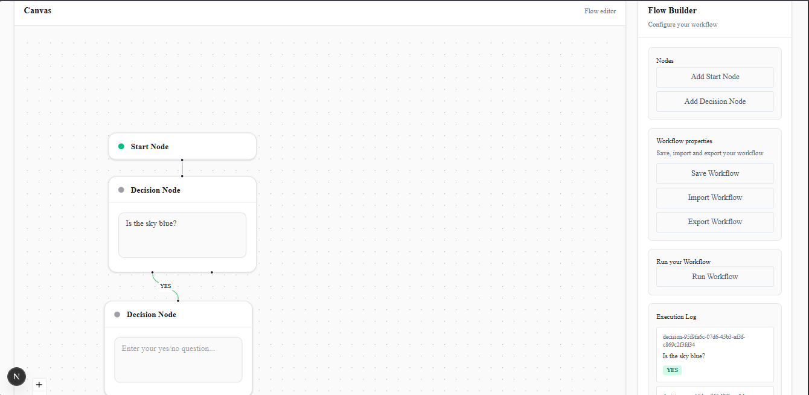

# AI Decision Flow

A visual workflow builder where each node represents an AI decision step that evaluates a prompt and returns `YES` or `NO`. Built with React Flow for the visual graph editor and Inngest for durable, step-based workflow execution.

## Stack

- **Next.js 15** (App Router, JavaScript, no TypeScript)
- **React Flow** (`@xyflow/react`) — visual graph editor
- **Inngest** — step-based async workflow execution
- **OpenAI SDK**, pointed at **OpenRouter** — LLM calls (free-tier models)
- **shadcn/ui** (Nova preset) — base components
- **Tailwind CSS**

## How it works

1. Build a graph on the canvas: a **Start Node** (entry point) connected to one or more **Decision Nodes**, each holding a yes/no prompt.
2. Each Decision Node has two outgoing handles — a YES edge and a NO edge — pointing to whichever node should run next.
3. Clicking **Run Workflow** sends the graph to `/api/run`, which fires an Inngest event (`workflow/run`) instead of executing directly.
4. Inngest's `runWorkflow` function traverses the graph: for each Decision Node, it calls the LLM (wrapped in `step.run()` for per-node retry and observability), reads the YES/NO answer, and follows the matching edge to the next node. The Start Node has no prompt — it just forwards to its one outgoing edge.
5. The frontend polls `/api/status?eventId=...` every 1.5s until the run completes, then renders the result in the **Execution Log** panel.

## Screenshots



## Setup

```bash
npm install
```

Create `.env.local`:

```.env
OPENAI_API_KEY=your_openrouter_key_here    # OR
OLLAMA_API_KEY=ollama    # With local LLM
OPENAI_BASE_URL=https://openrouter.ai/api/v1
INNGEST_DEV=1
```

Run both servers (two terminals):

```bash
npm run dev
npx inngest-cli@latest dev -u http://localhost:3000/api/inngest
```

Open `http://localhost:3000` for the app, `http://localhost:8288` for the Inngest dashboard.

## Features

- Interactive canvas: add Start/Decision nodes, connect them, edit prompts inline
- YES/NO edges are color-coded (green/red) and only applied to edges leaving a Decision Node — a Start Node's single outgoing edge is unlabeled by design
- Decision Nodes with an empty prompt halt the run at that node instead of sending a blank prompt to the LLM
- **Save/Load** — explicit save to `localStorage`, auto-loads on page refresh
- **JSON Export/Import** — download the graph as a `.json` file, re-upload it later; both paths share a single `attachNodeHandlers()` helper that reattaches the `onChange` callback Decision Nodes need (functions can't survive `JSON.stringify`)
- **Execution Log panel** — polls run status and renders each node's prompt + answer once the workflow completes

## Known limitation

Run results are held in an in-memory `Map` (`lib/workflow/store.js`), not Inngest's REST API. Inngest's dev-server REST endpoints (`/v1/events/{id}/runs`, `/v1/runs/{id}`) consistently returned an empty `output` field during development, despite the dashboard UI showing the correct output — likely a dev-server limitation rather
than a usage error. The in-memory store is a reliable workaround for local development, but it resets on server restart and would not survive multiple serverless instances in production. A production version should persist run results to a database instead.

## Project structure

```plain text
app/
    api/
        inngest/route.js # Inngest webhook handler
        run/route.js # triggers the workflow event
        status/route.js # frontend polls this for run state
    page.js # canvas + sidebar
    components/
    nodes/
        StartNode.jsx
        DecisionNode.jsx
    lib/
    inngest/
        client.js
        functions.js # runWorkflow — the actual graph traversal
    workflow/
        execute.js # standalone traversal (reference/fallback)
        store.js # in-memory run-result store
```
